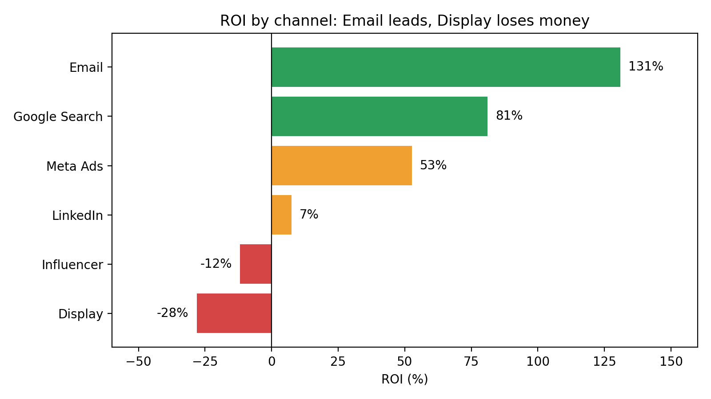
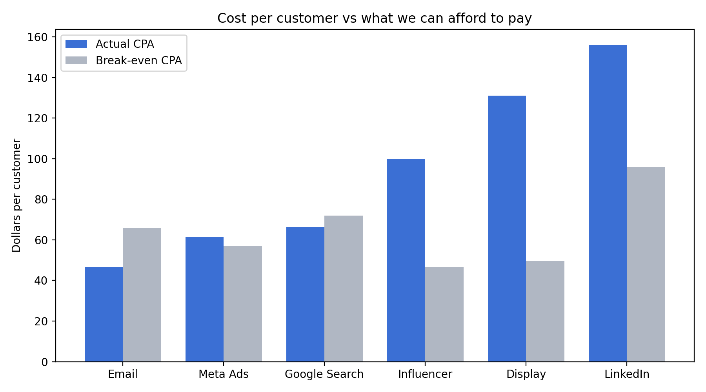

# Marketing Campaign Performance: Conversion, CPA and ROI

## Business problem
A company spends on six marketing channels but doesn't know which ones
actually make money. This project finds out.

## Key findings
- Email has the highest ROI (131%) and Google Search is next (81%).
- Influencer (-12%) and Display (-28%) lose money.
- Meta Ads looks profitable on ROI (53%) but its CPA is above break-even.
- Moving 20% of budget from the two weakest to the two strongest
  channels could add about $199K in revenue (+5%) at no extra spend.

## What I did
- Cleaned messy data: duplicates, inconsistent labels, mixed date
  formats, missing values, and a spend outlier
- Calculated CTR, CVR, CPA, ROI, and break-even CPA
- Compared CPA with break-even to label each channel Scale, Fix, or Pause
- Simulated a budget shift

## Charts

## Limitations
- The dataset is synthetic and built for practice.
- The simulation assumes constant returns as spend grows (optimistic).
- It ignores customer lifetime value and multi-channel attribution.

## Tools
Python (pandas, matplotlib), Google Colab

## Files
- `marketing_campaigns_raw.csv`: raw data
- `campaigns_clean.csv`: cleaned data
- `channel_summary.csv`: results per channel
